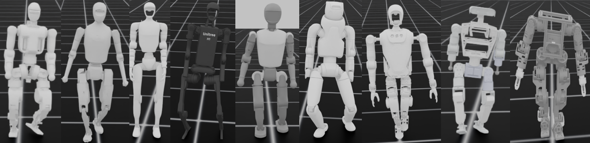

# MPBRS: Multi-Potential-Based Reward Shaping for Unified Reward Configuration in Humanoid Locomotion
<p align="center">
  
</p>

#### Key features of MPBRS:
- Multi-term potential-based reward shaping (MPBRS) for humanoid RL, combining interpretable terms such as uprightness, height regulation, and joint regularization.
- Dense, progress-based reward signals that improve learning stability and sample efficiency compared to ad-hoc reward bonuses.
- Easy to debug and tune; MPBRS supports multiple humanoid robots and is less sensitive to reward-weight tuning.
  
> [!NOTE]
> If you want this repo to support your robot, please send the robot files (`.xml`, `.urdf`, and meshes) or create an issue, we will support it asap. Please make sure that the robot files you sent can be open-sourced in this repo.

# Installation & Usage
The training was built on top of IsaacLab and run on Ubuntu 22.04 on a computer equipped with an Intel i7-9700F CPU and an NVIDIA GeForce RTX 2060 GPU (6 GB). The training took approximately 50 minutes for each robot.

**1**. Install IsaabLab and create the virtual environment:
```bash
Following the IsaacLab installation instructions for Ubuntu 22.04: https://isaac-sim.github.io/IsaacLab/main/source/setup/installation/pip_installation.html```
```

**2**. Install packages. Clone the package or download and unzip it:
```bash
source env_isaaclab/bin/activate
cd humanoid_locomotion && pip install -e .
cp trainhumanoidlocomotion.py playhumanoidlocomotion.py ~/IsaacLab/
cd ~/IsaacLab/
```

**3**. Running the packages (running and training was in the IsaabLab environment)
```bash
./isaaclab.sh -p trainhumanoidlocomotion.py --task Isaac-Humanoid-Locomotion --num_envs 2048 --headless
```
Note that nine humanoid robots are available for training: Fourier N1, Tienkung2, Unitree G1, Unitree H1, Booster T1, Fourier GR3V2, Kuavo S45, Hightorque HI, and Berkeley Humanoid Lite. To switch to a different robot, open env_cfg.py and change the robot name at line 2428.

**3**. Play the trained agent
```bash
./isaaclab.sh -p playhumanoidlocomotion.py   --task=Isaac-Humanoid-Locomotion   --num_envs 10   --checkpoint ~/IsaacLab/logs/rsl_rl/humanoid-locomotion/***/model_***.pt
*** should be replaced with: the training log folder name (the run directory), andthe saved model checkpoint file (e.g., model_1000.pt).
```


<p align="center">
  <video width="1000" controls>
    <source src="figures/demo.mp4" type="video/mp4">
    Your browser does not support the video tag.
  </video>
</p>

## Acknowledgement

Our method is developed and evaluated using nine humanoid robots. In the provided code, the robot models are imported into IsaacLab as USD files, and we provide the USD files rather than the URDF files. The original URDF robot models can be found at the following locations:
* [Fourier N1](https://github.com/FFTAI/Wiki-GRx-Gym): [Link to file](https://github.com/FFTAI/Wiki-GRx-Gym/tree/FourierN1/legged_gym/resources/robots/N1)
* [Kuavo S45](https://gitee.com/leju-robot/kuavo-ros-opensource/blob/master/LICENSE)
* [Berkley Humanoid Lite](https://github.com/HybridRobotics/Berkeley-Humanoid-Lite-Assets)
* [Booster T1](https://booster.feishu.cn/wiki/UvowwBes1iNvvUkoeeVc3p5wnUg): [Link to file](https://booster.feishu.cn/wiki/DtFgwVXYxiBT8BksUPjcOwG4n4f)
* [HighToqure Hi](https://www.hightorquerobotics.com/hi/)
* [Unitree G1](https://github.com/unitreerobotics/unitree_ros): [Link to file](https://github.com/unitreerobotics/unitree_ros/tree/master/robots/g1_description)
* [Unitree H1](https://github.com/unitreerobotics/unitree_ros): [Link to file](https://github.com/unitreerobotics/unitree_ros/tree/master/robots/h1_description)
* [Tienkung2](https://github.com/Open-X-Humanoid): [Link to file](https://github.com/Open-X-Humanoid/TienKung_URDF)
* [Fourier GR3V2](https://github.com/FFTAI): [Link to file](https://github.com/FFTAI/Wiki-GRx-Models/tree/master/GRX/GR3/gr3v2_1_1)
